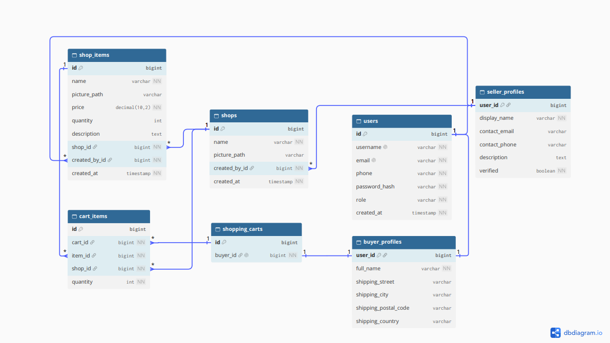

# 🛒 TradeHub

A multi-role marketplace built with Spring Boot and Angular. Sellers open shops and list items, buyers browse every shop and fill a shopping cart, and an administrator moderates the content. JWT authentication and role-based access control keep each role in its own lane.


---

## Features

- **Three roles**: buyers, sellers and an administrator, each with its own permissions on the backend and its own views on the frontend
- **JWT authentication**: stateless login, with passwords hashed using BCrypt
- **Separate registration flows**: buyers sign up with a full name and shipping address, sellers with a display name and contact details
- **Multi-seller shops**: a seller can own several shops, each with a cover picture
- **Shop items**: each item has a picture, a price and a stock quantity
- **Shopping cart**: buyers can add items, change quantities, remove items or clear the cart, and quantities are checked against stock
- **Image uploads**: JPEG, PNG and WEBP up to 5 MB, stored on disk and served from `/uploads/**`
- **Admin moderation**: an admin account is created on startup and can delete any shop or item
- **Consistent API responses**: every endpoint returns an `ApiResponse` envelope with a user-facing message, a log message and the data
- **Central error handling**: domain exceptions map to proper HTTP statuses in `GlobalExceptionHandler`, and the frontend interceptor shows them in an error dialog

---

## Architecture

```
┌──────────────────────────────────────────────────────────┐
│                   Angular Frontend (:4200)               │
│                                                          │
│  Components  ──►  Services  ──►  HttpClient              │
│      ▲                              │                    │
│   Guards              Request / Error Interceptors       │
└─────────────────────────────────────┼────────────────────┘
                     REST + JWT       │  JSON / multipart
┌─────────────────────────────────────┼────────────────────┐
│                   Spring Boot Backend (:8080)            │
│                                     ▼                    │
│   JwtFilter  ──►  Controllers  ──►  Services  ──►  Repos │
│                        │               │            │    │
│                      DTOs ◄─ Mappers ─ Entities     │    │
│                                        │            │    │
│                            FileStorage (uploads/)   │    │
└─────────────────────────────────────────────────────┼────┘
                                                      ▼
                                              PostgreSQL 16
```

The frontend talks to the backend only through the REST API under `/api/v1`. The request interceptor attaches the JWT to every call. `JwtFilter` validates it and fills the Spring Security context, so role checks run in `SecurityConfiguration` and ownership checks run in the service layer.

---

## Roles & Permissions

| Action | Buyer | Seller | Admin |
|---|:---:|:---:|:---:|
| Browse shops and items | ✅ | ✅ | ✅ |
| Create shops and items | | ✅ | |
| Delete own shops and items | | ✅ | |
| Delete any shop or item | | | ✅ |
| Manage a shopping cart | ✅ | | |

---

## Database Schema



- `users` holds credentials and the role. Buyer and seller data live in `buyer_profiles` and `seller_profiles`, which share the user's primary key.
- `shops` belong to a seller, and `shop_items` belong to a shop.
- Each buyer has one `shopping_carts` row. Its `cart_items` point at `shop_items`.

---

## API Overview

All endpoints are prefixed with `/api/v1`. Every endpoint except register and login needs an `Authorization: Bearer <token>` header.

| Method | Endpoint | Access | Description |
|---|---|---|---|
| `POST` | `/auth/register/buyer` | Public | Register a buyer |
| `POST` | `/auth/register/seller` | Public | Register a seller |
| `POST` | `/auth/login` | Public | Log in and receive a JWT |
| `GET` | `/user/preview` | Authenticated | Current user preview |
| `GET` | `/user/buyer` | Authenticated | Buyer profile |
| `GET` | `/user/seller` | Authenticated | Seller profile |
| `GET` | `/shops` | Authenticated | All shops (optional `?userId=`) |
| `GET` | `/shops/my` | Authenticated | The current seller's shops |
| `GET` | `/shops/{id}` | Authenticated | Shop details with its items |
| `POST` | `/shops` | Seller | Create a shop (multipart: `shop` + `picture`) |
| `DELETE` | `/shops/{id}` | Owner / Admin | Delete a shop |
| `GET` | `/shop-items/{id}` | Authenticated | Item details |
| `POST` | `/shop-items` | Seller | Create an item (multipart: `item` + `picture`) |
| `DELETE` | `/shop-items/{id}` | Owner / Admin | Delete an item |
| `GET` | `/cart` | Buyer | View the cart |
| `POST` | `/cart/items` | Buyer | Add an item to the cart |
| `PATCH` | `/cart/items/{cartItemId}` | Buyer | Change an item's quantity |
| `DELETE` | `/cart/items/{cartItemId}` | Buyer | Remove an item from the cart |
| `DELETE` | `/cart` | Buyer | Clear the cart |

---

## Tech Stack

**Backend**
- **Java 25** and **Spring Boot 4.1**: Web MVC, Data JPA, Security, Validation
- **[JJWT](https://github.com/jwtk/jjwt)** to issue and validate JWTs
- **PostgreSQL 16** for the database
- **Lombok** to reduce boilerplate
- **Maven** (wrapper included) for builds

**Frontend**
- **Angular 22** with standalone components and signals
- **Angular Material** for UI components (azure-blue theme)
- **RxJS** for HTTP and state streams
- **Vitest** for unit tests

**Infrastructure**
- **Docker** and **Docker Compose**: a multi-stage backend image, a Postgres container, and persistent volumes for the database and uploads

---

## Getting Started

### Prerequisites

- Docker and Docker Compose
- Node.js and npm (for the frontend)
- JDK 25 (only if you run the backend outside Docker)

### Clone

```bash
git clone https://github.com/TrayanDKirov/TradeHub.git
cd TradeHub/TradeHub-Source-Code
```

### Running the backend (Docker)

```bash
cd tradehub-backend
docker compose up --build
```

This starts PostgreSQL on `localhost:5432` and the backend on `http://localhost:8080`. Tables are created automatically from the JPA entities, and uploaded pictures are kept in the `tradehub-uploads` volume.

### Running the backend locally (without Docker)

Start only the database container, then run Spring Boot with the datasource settings:

```bash
cd tradehub-backend
docker compose up -d db

export SPRING_DATASOURCE_URL=jdbc:postgresql://localhost:5432/tradehub
export SPRING_DATASOURCE_USERNAME=tradehub
export SPRING_DATASOURCE_PASSWORD=tradehub
export SPRING_JPA_HIBERNATE_DDL_AUTO=update

./mvnw spring-boot:run
```

### Running the frontend

```bash
cd tradehub-frontend
npm install
npm start
```

Open `http://localhost:4200`. The development environment points to the backend at `http://localhost:8080/api/v1`, and CORS on the backend allows `http://localhost:4200`.

### Admin account

An admin user is created on first startup from `application.properties`:

```properties
admin.username=admin
admin.password=admin1234
```

Log in at `/admin/login`. **Change these credentials before deploying anywhere public.**

---

## Project Structure

```
TradeHub-Source-Code/
├── tradehub-backend/
│   ├── Dockerfile                  # Multi-stage build (JDK → JRE)
│   ├── docker-compose.yml          # Postgres + backend + volumes
│   └── src/main/java/bg/sofia/uni/fmi/tdkirov/tradehub/
│       ├── config/                 # AdminInitializer, static uploads mapping
│       ├── controller/             # REST controllers (auth, user, shop, shop item, cart)
│       ├── dto/                    # Request/response DTOs and the ApiResponse envelope
│       ├── entity/                 # JPA entities: user, shop, cart
│       ├── exception/              # Domain exception hierarchy
│       ├── handler/                # GlobalExceptionHandler
│       ├── mapper/                 # Entity ↔ DTO mappers
│       ├── repository/             # Spring Data JPA repositories
│       ├── security/               # JwtFilter, JwtUtil, SecurityConfiguration
│       └── service/                # Service interfaces and implementations
└── tradehub-frontend/
    └── src/app/
        ├── components/             # admin, cart, dialog, home, shop, shop-item, user
        ├── dtos/                   # TypeScript mirrors of the backend DTOs
        ├── guards/                 # AuthGuard, AdminGuard
        ├── interceptors/           # JWT request interceptor, error interceptor
        ├── services/               # API services (auth, user, shop, shop item, cart)
        └── utils/                  # ApiResponse RxJS operators
```

---

## Potential Improvements

- **Checkout and orders**: turn a cart into an order, reduce stock, and show order history to buyers and sellers
- **Editing**: update shops, items and profiles (only create and delete exist right now)
- **Admin dashboard**: a dedicated admin area that uses `AdminGuard`, with user management
- **Seller verification**: `seller_profiles.verified` exists in the schema but nothing sets or checks it yet
- **Change password**: add a password change flow for users
- **Search, filtering and pagination**: for the shop and item lists
- **Database migrations**: use Flyway or Liquibase instead of `ddl-auto=update`
- **Externalised secrets**: move the admin credentials to environment variables and load the JWT signing key from configuration. Right now it is generated at startup, so every restart logs all users out
- **Test coverage**: unit and integration tests for services, controllers and components